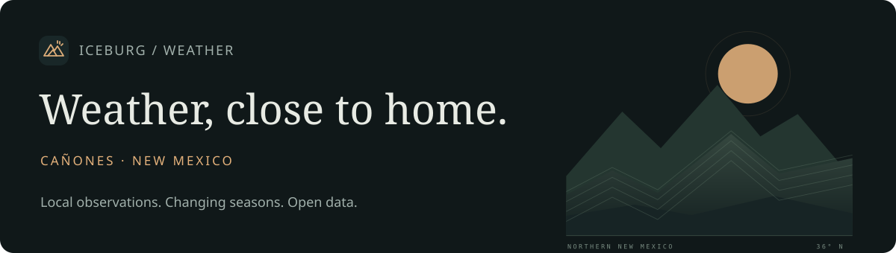
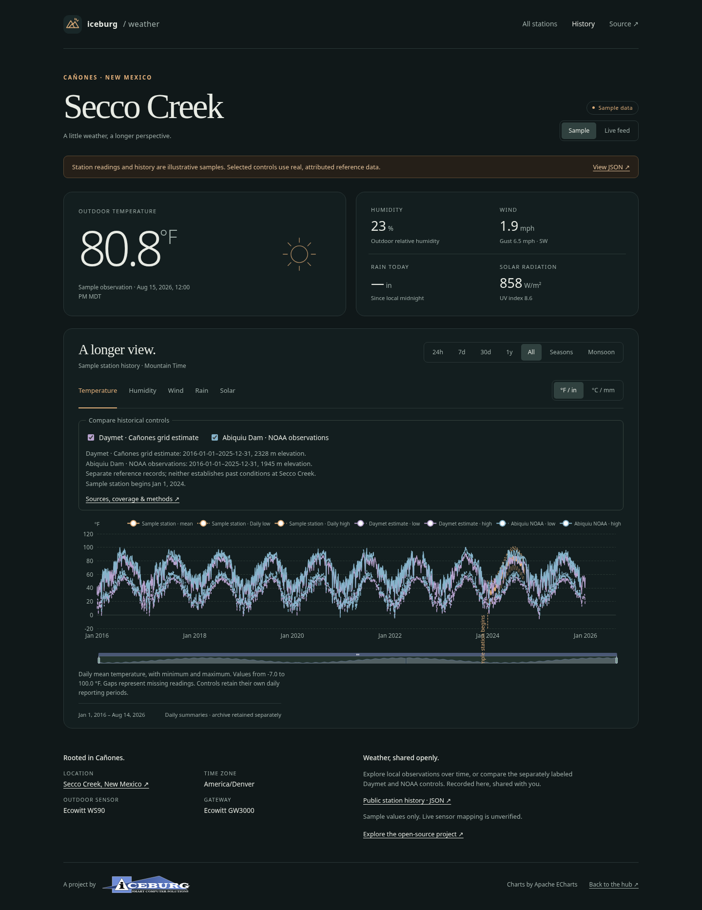

# Cañones weather



Local weather from Secco Creek in Cañones, New Mexico. A small, open-source
project for exploring observations through the day, across seasons, and over
the years—with a public dashboard and reusable data.

[Weather hub](https://weather.iceburg.net) ·
[Cañones station](https://canones.weather.iceburg.net)

## A window into the weather

- Efficient publishing from Ecowitt hardware and a Raspberry Pi, using local
  collection, Cloudflare Pages, and R2 storage designed to fit free-tier allowances.
- A responsive, dark-only dashboard with interactive weather charts, selectable
  units, seasonal views, and separately attributed Daymet/NOAA historical controls.
- Reusable JSON observations with timestamps and sensor sources, decoupling
  data collection from the website.

<details>
<summary>See the station dashboard · sample data</summary>



</details>

## Explore locally

With Python 3.11+ installed:

```sh
git clone https://github.com/briceburg/canones-weather.git
cd canones-weather
bin/build-site
python3 -m http.server 8000 --directory dist
```

Open the [hub](http://localhost:8000/hub/) or
[station dashboard](http://localhost:8000/canones/). No gateway or cloud account
is needed to explore the sample site.

See [historical controls and source methods](docs/reference-data.md) or
[publishing and discovery](docs/publishing.md) for data provenance and contribution channels.

## Have an Ecowitt gateway?

The included read-only tool retrieves observations and sensor information from a
GW3000 on your network. Install [uv](https://docs.astral.sh/uv/), then:

```sh
cp .env.example .env
```

Set `WEATHER_GATEWAY_URL` in your local `.env` to the gateway's HTTP(S) origin,
preferably using a local DNS name. Keep deployment addresses in `.env`;
`.env.example` documents the configuration keys without personal values. Then run:

```sh
uv run --env-file .env canones-weather
```

To save a capture, add `--output captures/current.json`. The tool does not change
gateway settings or upload observations. Sensor information covers the first inventory page. `.env` and captures are excluded from Git.

## Learn more or build your own

| Guide | What you'll find |
| --- | --- |
| [Station notes](docs/station.md) | Equipment, siting, and collection requirements |
| [Raspberry Pi setup](deploy/raspberry-pi/README.md) | Isolated WeeWX pilot, preflight, and local data snapshots |
| [Website](site/README.md) | Shared design, local previews, and charting |
| [Public data](docs/data.md) | Observation and history format |
| [Hosting](opentofu/README.md) | Cloudflare Pages/R2 setup with separate prod/notprod environments |

## Contributing

[Issues](https://github.com/briceburg/canones-weather/issues) and
[pull requests](https://github.com/briceburg/canones-weather/pulls) are welcome.
See [CONTRIBUTING.md](CONTRIBUTING.md) for local checks relevant to your changes.

## License

[MIT](LICENSE) for original project code, infrastructure, and weather artwork.
Third-party software and branding retain their own licenses and ownership; see
[website credits](site/README.md#third-party-software).
